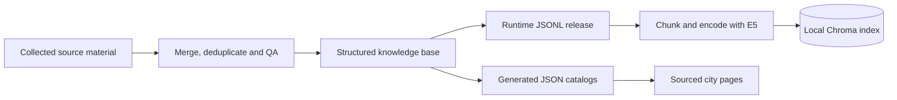
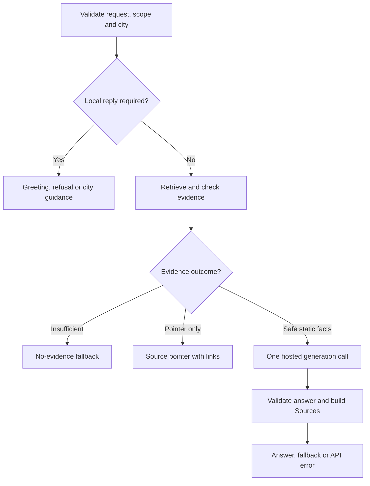

# Mein Oberfranken

_A local student demonstrator for discovering Bamberg and Bayreuth, with a source-backed RAG chatbot._

---

Explore local traditions, regional food, cultural places, history, newcomer information and activities. The website offers English and German content, city pages, category discovery and a chatbot that displays its sources.

This is a two-city prototype, not a complete guide to Upper Franconia. It runs locally. Legal pages are demo drafts, and live answer quality is only partly evaluated. This README describes the published baseline; unfinished geography/clarification work is not a released feature.

## 📋 Contents

- [Features and scope](#-features-and-scope)
- [Architecture](#-architecture)
- [Install and run](#-install-and-run)
- [Configuration and API](#-configuration-and-api)
- [Source transparency](#-source-transparency)
- [Checks and troubleshooting](#-checks-and-troubleshooting)
- [Privacy and deployment](#-privacy-and-deployment)
- [Repository policy and credits](#-repository-policy-and-credits)

## 🎯 Features and scope

- Bamberg and Bayreuth pages with sourced local information
- Homepage discovery for **Sport**, **Sights** and **Restaurants**, followed by city and section navigation
- Culture, Activities and Newcomer sections on each city page
- A real HTTP chatbot with source cards, limited-source labels and manual retry
- Local multilingual retrieval and optional hosted AI generation
- OpenStreetMap embeds behind a separate map opt-in

An example journey is: open Home, choose a language, select Categories / Restaurants / Bamberg, read an entry, ask a follow-up question, then open the cited source. Map acceptance is optional and does not authorize or block chat.

Medical advice, legal advice, job advice, live housing searches and personal immigration advice are outside the pilot. Current hours, prices, availability and event details use source pointers rather than generated live claims. Unsupported rankings and constraints must not become invented recommendations.

City context normally comes from the current page or an explicit city in the question. Conflicting cities produce guidance. Home discovery can ask for a city, but this baseline does not resume the original question through city-choice buttons. An explicitly regional university overview supports both pilot universities; general balanced two-city answers across every topic are not implemented in the published baseline.

## 🏗️ Architecture

### Components

| Layer | Technology | Role |
| --- | --- | --- |
| Frontend | React 19, TypeScript, Vite | Pages, chat and development proxy |
| Interface | Tailwind CSS, shadcn/ui, Radix UI | Styling and accessible controls |
| Backend | Python 3.11, FastAPI, Pydantic, Uvicorn | Request validation and chat orchestration |
| Embeddings | Sentence Transformers, multilingual E5 | Local document/query vectors |
| Vector storage | ChromaDB | Persistent cosine retrieval |
| Model gateway | OpenRouter | One request to the configured endpoint |
| Answer model | DeepSeek v4.1 Flash via DeepInfra | Generation from supplied evidence |
| Verification | pytest, Vitest, Testing Library | Backend and UI regression tests |

E5 retrieves information; DeepSeek writes answers. They are different models with different jobs. The project uses pretrained models, with no training or fine-tuning. Laya is not part of this runtime.

```mermaid
flowchart LR
    accTitle: Local and hosted RAG architecture
    accDescr: The browser uses FastAPI for chat. Local E5 and Chroma retrieve evidence, while qualified generation uses OpenRouter and DeepInfra. Generated catalogs supply the city pages independently.
    subgraph local_runtime ["Local runtime"]
        browser_ui["React browser UI"]
        chat_api["FastAPI chat service"]
        query_encoder["Local E5 query encoder"]
        vector_index[("Chroma vector index")]
        evidence_checks["Evidence and answer checks"]
        page_catalogs["Generated page catalogs"]
    end
    subgraph hosted_generation ["Hosted generation"]
        model_gateway["OpenRouter gateway"]
        answer_model["DeepInfra / DeepSeek"]
    end
    page_catalogs --> browser_ui
    browser_ui -->|POST /api/chat| chat_api
    chat_api --> query_encoder
    query_encoder --> vector_index
    vector_index --> evidence_checks
    evidence_checks -->|Qualified evidence| model_gateway
    model_gateway --> answer_model
    answer_model -->|Generated reply| evidence_checks
    evidence_checks -->|Answer or local reply| chat_api
    chat_api -->|Text and Sources| browser_ui
```



### Data preparation

The active release contains **251 parent records and 253 vectors**. Two long records require multiple lossless chunks. The pinned `intfloat/multilingual-e5-small` model produces normalized 384-dimensional vectors. Chunk inputs respect a 512-token limit. Records and queries use the `passage: ` and `query: ` prefixes respectively.



The repository includes machine-readable release inputs, not private authoring notes or the exporter workspace. Do not manually edit pinned release files or change their hashes to bypass validation.

### Answer decisions



Evidence availability alone does not trigger a model call. Source pointers, greetings and scope refusals run locally. Provider configuration, paid-call permission, budget and deadline checks can also prevent generation. Citation checks reduce errors but do not prove sentence-level factual correctness.

## 🚀 Install and run

### Requirements

The macOS recipe below targets **Apple Silicon (M1 or newer), macOS 14 or newer**. The current Python lockfile contains an ARM64/macOS-14 PyTorch wheel; Intel Mac installation is not supported by this recipe. A clean second-device installation has not yet completed end-to-end acceptance.

| Requirement | Version or condition |
| --- | --- |
| Git | Available in Terminal |
| Node.js and npm | Node 24 LTS recommended |
| Python | Exactly the 3.11 series, installed through uv |
| uv | Available in Terminal |
| Internet | Initial package/model downloads and hosted generation |
| OpenRouter account | Key and available credit for generated live answers only |

Install Git through Xcode Command Line Tools if necessary:[^1]

```bash
xcode-select --install
```

Install the macOS Node.js 24 LTS installer from the official download page.[^2] It includes npm. Install uv:[^3]

```bash
curl -LsSf https://astral.sh/uv/install.sh | sh
```

Finish the installers, then reopen Terminal and check:

```bash
git --version
node --version
npm --version
uv --version
uname -m
sw_vers -productVersion
```

For the macOS recipe, `uname -m` should report `arm64`. Python, Chroma and the embeddings model do not require separate database servers. Other operating systems require their own tool installation and have not been validated here.

### 1. Clone the platform

```bash
cd ~/Documents
git clone https://github.com/Al1mk/project-oberfranken.git
cd project-oberfranken
```

If the repository is private, request access and authenticate to GitHub. Keep the `ui`, `backend` and `data` directories together. The clone root is already the full project; do not move the UI away from `data`.

### 2. Install and validate the backend

```bash
cd backend
uv python install 3.11
uv sync --frozen --python 3.11
uv run --frozen python -c "import oberfranken_rag; print(oberfranken_rag.__file__)"
uv run --frozen oberfranken-rag validate-data
```

The import should resolve to this clone's `backend/src/oberfranken_rag/__init__.py`. Data validation should report `record_count: 251`. Stop on an error; use the import recovery below if necessary. `--frozen` preserves the committed lockfile.

### 3. Build embeddings and the local index

```bash
uv run --frozen oberfranken-rag --model-cache model_cache build-index
uv run --frozen oberfranken-rag inspect-index
```

The first command downloads the pinned E5 model and builds Chroma under `backend/storage`. It can take several minutes. Expect 251 parents and 253 vectors. This performs local inference, not training, and makes no OpenRouter call.

Do not enable Hugging Face offline mode before the first model download. After setup, test retrieval without a provider key:

```bash
HF_HUB_OFFLINE=1 uv run --frozen oberfranken-rag --model-cache model_cache query "Was ist Rauchbier?" --city bamberg
```

This prints retrieved records, not a generated conversational answer. Preserve the model cache and index between runs; they are intentionally absent from GitHub.

### 4. Configure optional hosted generation

Still inside `backend`:

```bash
cp -n .env.example .env
open -e .env
```

For live AI answers, edit and save the following values locally:

```dotenv
OPENROUTER_API_KEY=YOUR_REAL_OPENROUTER_KEY
OPENROUTER_MODEL=deepseek/deepseek-v4.1-flash
OPENROUTER_PROVIDER_ENDPOINT=deepinfra/fp8
OPENROUTER_ALLOW_PAID_CALLS=0
OPENROUTER_BUDGET_USD=1.00
```

The key placeholder is not a working credential. To authorize billable answers, replace it with a valid key, ensure the account has credit, then change `OPENROUTER_ALLOW_PAID_CALLS` to `1`. Restart the backend after any configuration change. The cumulative application budget is capped at US$1 per local ledger.

Without a configured/enabled provider, local retrieval and deterministic replies still work; questions requiring generation return an explicit service error. They never silently become mock answers. Keep keys in `backend/.env`, not frontend `VITE_` variables.

The model/endpoint pair must be approved in [backend settings](backend/src/oberfranken_rag/chat/settings.py). Do not substitute a Pro model or another provider without updating and reviewing the corresponding pricing controls. External model availability is not guaranteed by this repository.

### 5. Start the backend in Terminal 1

```bash
cd ~/Documents/project-oberfranken/backend
uv run --frozen uvicorn --factory oberfranken_rag.chat.api:create_app_from_env --host 127.0.0.1 --port 8000 --no-access-log
```

Leave this terminal open. Visit <http://127.0.0.1:8000/api/health>; expect `{"status":"ok"}`. This checks process availability, not provider credentials or answer quality.

### 6. Install and start the UI in Terminal 2

```bash
cd ~/Documents/project-oberfranken/ui
npm ci
cp -n .env.example .env.local
open -e .env.local
```

Change the copied setting to:

```dotenv
VITE_ASSISTANT_MODE=http
```

Save the file, then run:

```bash
npm run dev -- --host 127.0.0.1 --port 5173 --strictPort
```

Open <http://127.0.0.1:5173/>, <http://127.0.0.1:5173/bamberg> or <http://127.0.0.1:5173/bayreuth>. Both terminals must remain open. On the Bamberg page, try `What is Rauchbier, and what gives it its smoky taste?` after enabling hosted generation.

If development mode is unset, the UI uses labelled mock replies. Vite loads env files at startup, so restart it after changing `.env.local`. For an intentional UI-only demonstration, set the mode to `mock`; this uses prepared examples, not RAG answers.

### Later runs and shutdown

Repeat only the two server-start commands. Reinstalling packages or rebuilding the index is unnecessary while the release, pinned dependencies and Python version remain unchanged.

Press **Control+C** in each server terminal to stop the demo. Set the paid-call flag back to `0` before the next backend start if you no longer want billable generation. Do not delete the budget ledger to reset spending.

## ⚙️ Configuration and API

The browser calls the fixed same-origin `/api/chat`. Vite proxies `/api` to `127.0.0.1:8000` during development; no browser model key is needed.

| Setting | Purpose |
| --- | --- |
| `VITE_ASSISTANT_MODE` | `http` for real backend; `mock` for development examples |
| `OPENROUTER_API_KEY` | Backend provider credential |
| `OPENROUTER_MODEL` | Approved answer model |
| `OPENROUTER_PROVIDER_ENDPOINT` | Required exact approved endpoint |
| `OPENROUTER_ALLOW_PAID_CALLS` | Explicit permission for generation |
| `OPENROUTER_BUDGET_USD` | Positive cumulative budget, capped at 1.00 |

### Endpoints

- `GET /api/health`: process health
- `POST /api/chat`: one stateless chat request

The published request fields are `message`, `city` (`bamberg`, `bayreuth`, or `null`) and `language` (`en` or `de`). Response fields are `text`, `kind`, `isSample` and `sources`; published kinds are `answer`, `out-of-scope` and `fallback`.

Try a deterministic greeting without a provider call:

```bash
curl -sS http://127.0.0.1:8000/api/chat \
  -H 'Content-Type: application/json' \
  -d '{"message":"Hello","city":"bamberg","language":"en"}'
```

Expect an HTTP-mode reply with `isSample: false`, `kind: fallback`, a greeting and an empty sources array. Source pointers use `kind: answer` and contain sources even though no model generated them.

Backend limits include a 500-character message, an 8 KB body, 20 requests per minute, a 25-second overall deadline and one provider call at a time. The HTTP client has a 30-second timeout. There is no automatic provider retry or provider fallback. A manual retry can create another billable call if generation is reached.

## 🔍 Source transparency

Each record retains an ID, city, topic, source URLs, retrieval date, QA status and temporal/answer policy. The active corpus contains 56 `verified`, 187 `source_backed` and 8 `limited` records. These are not 251 independently verified recommendations.

The discovery catalog has 22 verified cards. Culture/Activities/Newcomer pages use 18 generated cards, including limited entries. Source cards display publisher, URL, retrieval date and status. Both `source_backed` and `limited` become `limited` in the chat API; status is never upgraded.

The model returns record IDs. The server builds source cards from owned record provenance, validates citations and checks certain unsupported numbers and volatile claims. A retrieval date is not a freshness guarantee. Citation validity is not proof that every answer sentence is supported.

The release identity and model revision are pinned in [backend configuration](backend/src/oberfranken_rag/config.py); artifact hashes are in [the v3.2 manifest](data/v3.2/manifest.json). Chroma uses cosine retrieval, deduplicated parent records and city/topic metadata filters. City retrieval includes shared Oberfranken records. Chat uses bounded intent/entity rules and conservative evidence thresholds; this is not unrestricted language understanding.

## 🧪 Checks and troubleshooting

### Quality checks

From `backend`, after the local index/model setup:

```bash
uv run --frozen pytest -q
HF_HUB_OFFLINE=1 uv run --frozen oberfranken-rag --model-cache model_cache evaluate
```

From `ui`:

```bash
npm run lint
npm run typecheck
npm test
npm run build
```

Tests use fake providers; real-index integration tests need the local index/cache, and some skip when it is missing. Inspect skipped tests. The frozen 26-question German/English evaluation measures retrieval, not live prose accuracy. Threshold calibration used this small dataset, so it is not an independent held-out benchmark. Browser and manual live-answer acceptance remain incomplete.

### Import error: `No module named 'oberfranken_rag'`

The CLI wrapper exists but Python cannot resolve the source package. From this clone's `backend` directory:

```bash
ls src/oberfranken_rag/cli.py
uv sync --frozen --python 3.11 --reinstall-package oberfranken-rag
uv run --frozen python -c "import oberfranken_rag; print(oberfranken_rag.__file__)"
uv run --frozen oberfranken-rag validate-data
```

If the source file is missing, repair/check the clone first. If import still fails, collect the full command output and resolved path instead of deleting `.venv` or changing the lockfile. Reinstallation is a targeted recovery step, not a confirmed diagnosis of every possible import failure. Do not copy another computer's `.venv`.

### Other common issues

| Symptom | Next check |
| --- | --- |
| `uv` or `npm` not found | Reopen Terminal after installation and check tool versions |
| PyTorch installation fails on Mac | Check native ARM64 and macOS 14+; Intel/Rosetta is outside this recipe |
| UI shows sample replies | Set mode to `http`, restart Vite and reload the page |
| HTTP 502 / connection refused | Check that the backend is running on port 8000 |
| HTTP 503 | Read the error code: provider configuration, disabled paid calls or budget exhaustion are different causes |
| HTTP 429 | Respect the rate limit or wait for the active generation call |
| HTTP 504 | Request exceeded its deadline; do not trigger repeated automatic sends |
| Model missing in offline mode | Finish the first online `build-index` using `--model-cache model_cache` |
| Index dependency/hash mismatch | Restore pinned inputs/versions; preserve the old index and investigate before rebuilding |
| Source pointer or no-evidence reply | This can be a deliberate evidence limitation, not a connection error |
| Port 5173 or 8000 is occupied | Stop the known existing demo process; do not blindly kill unrelated services |

## 🔐 Privacy and deployment

Chat messages remain in page memory. The application does not persist conversation history or insert user messages into Chroma. Qualified questions and selected static evidence go to OpenRouter and the configured model provider. Do not include personal data in demo questions.

Map choices and chat-notice acknowledgement remain in memory and reset on reload. They are independent. OpenStreetMap embeds do not load before opt-in; withdrawal removes them. The language preference uses localStorage. The demo's own code does not set cookies, but the embedded map's storage has not been fully audited.

The application log omits question text, evidence and credentials. The documented `--no-access-log` avoids Uvicorn's default access log. The separate local budget ledger stores numeric usage/cost information.

`/impressum` and `/datenschutz` are internal demo drafts. **Project Group 7** is a project label, not a confirmed legal operator. Actual operator/address/contact/hosting details remain unresolved; `example@gmail.com` is explicitly a non-contact demo example. No public-release or GDPR-compliance approval is claimed.

`npm run build` creates frontend assets only. A deployed site also needs the Python service, model/index storage, API routing, HTTPS and resolved operational/legal details. Vite's development proxy is not included in a static deployment. No ChatGPT-domain hosting, Docker workflow or production deployment is supplied here.

## 📦 Repository policy and credits

```text
project-oberfranken/
├── README.md                  Public setup and architecture guide
├── .gitignore                 Private/generated-file exclusions
├── ui/                        Frontend source, assets, tests and npm lockfile
├── backend/                   RAG/API source, tests and uv lockfile
│   ├── evaluation/            Frozen retrieval questions
│   ├── model_cache/           Generated locally; ignored
│   └── storage/               Generated index and ledger; ignored
└── data/
    ├── v3.1/                  Preserved machine-readable previous release
    └── v3.2/                  Active JSONL, catalogs and manifest
```

Only the root README is exempt from the private-Markdown exclusion. Personal Obsidian notes, AI instruction files, authoring Markdown, reports, real env files, dependencies and generated caches/indexes stay out of Git. Sanitized `.env.example` files and dependency lockfiles are included. Ignoring a file does not untrack an already committed file; review staged paths before publishing.

Project Group 7 is a student demonstrator for Coburg's Project and Trend Management course. Ali Moradkhani works on UI, backend, RAG and data merging. Armin Nour Mohammadi contributes sources and data collection. Roles for other team members are not assigned here.

Source-site content and images retain their respective rights. UI photo attribution is recorded in [photo metadata](ui/src/data/photos.ts). This repository does not provide a blanket open-source license for all code, data and third-party assets.

Official installation references:

[^1]: Git. Install for macOS. https://git-scm.com/install/mac
[^2]: Node.js. Official downloads. https://nodejs.org/en/download
[^3]: Astral. Installing uv. https://docs.astral.sh/uv/getting-started/installation/
